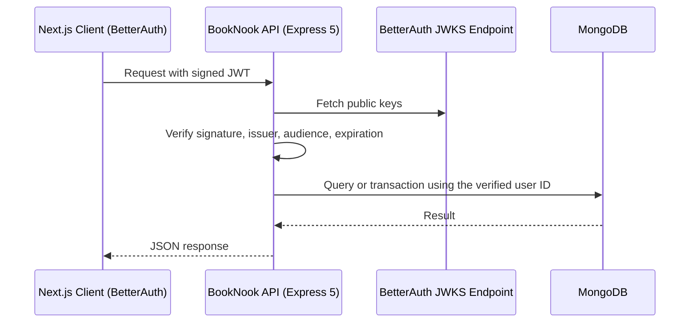

# BookNook API

A RESTful backend for the BookNook online library platform, built with Express 5 and MongoDB. It exposes a public book catalog and a JWT-protected borrowing workflow, and verifies BetterAuth-issued tokens independently on the server.

[Overview](#overview) · [Architecture](#architecture) · [API Reference](#api-reference) · [Getting Started](#getting-started) · [Deployment](#deployment)

| | |
| --- | --- |
| **Client application** | `ADD-CLIENT-REPO-LINK` |
| **Live API** | `ADD-RENDER-URL` |

---

## Table of Contents

1. [Overview](#overview)
2. [Architecture](#architecture)
3. [Tech Stack](#tech-stack)
4. [Features](#features)
5. [API Reference](#api-reference)
6. [Data Model](#data-model)
7. [Business Rules and Data Integrity](#business-rules-and-data-integrity)
8. [Authentication and Security](#authentication-and-security)
9. [Getting Started](#getting-started)
10. [Testing](#testing)
11. [Deployment](#deployment)
12. [Database Seeding](#database-seeding)
13. [Author](#author)

---

## Overview

BookNook lets readers browse a shared catalog, add their own books, and borrow or return copies. This repository contains the API server only. Authentication is handled by BetterAuth in the separate Next.js client, and this server never trusts identity data sent by the client. Instead, it verifies each token itself against BetterAuth's public JWKS endpoint, checking the Ed25519 signature, issuer, audience and expiration.

The API is intentionally small, with exactly eight application endpoints, and focuses on correctness: ownership checks, transactional stock updates and protection against duplicate or concurrent borrows.

## Architecture



BetterAuth's own authentication, token and JWKS endpoints live in the Next.js client, outside these eight Express routes.

## Tech Stack


| Layer | Technology |
| --- | --- |
| Runtime | Node.js 22.20+ or 24 LTS |
| Framework | Express 5 |
| Database | MongoDB Atlas or any replica set (transactions required) |
| Authentication | BetterAuth tokens, verified via JWKS (Ed25519 JWT) |
| Testing | Unit and security tests, plus integration tests on `mongodb-memory-server` |
| Hosting | Render |

## Features

- Public catalog with search, category filter, availability filter, sorting and pagination
- Server-side sorting and limiting for the New Arrivals section
- Server-verified identity for every protected route
- Owner-only editing and deletion of books
- Borrow and return operations wrapped in MongoDB transactions
- Unique-index protection against duplicate active borrows
- Stock safeguards against negative or double-counted copies
- Owner email omitted from user list and detail responses
- Idempotent seed script with 26 curated titles

## API Reference

| Method | Route | Access | Description |
| --- | --- | --- | --- |
| `GET` | `/books` | Public | Book catalog. With `mine=true`, requires a JWT and returns only the verified owner's books |
| `GET` | `/books/:id` | JWT | Full book details and the current reader's borrow state |
| `POST` | `/books` | JWT | Add a book under the verified owner |
| `PATCH` | `/books/:id` | JWT + owner | Update a book |
| `DELETE` | `/books/:id` | JWT + owner | Delete a book (only when all copies are returned) |
| `POST` | `/borrows` | JWT | Borrow one available copy for seven days |
| `GET` | `/borrows` | JWT | List the verified reader's active borrows |
| `DELETE` | `/borrows/:id` | JWT + owner | Return a borrowed book |

### Catalog query parameters (`GET /books`)

| Parameter | Description |
| --- | --- |
| `search` | Text search across the catalog |
| `category` | Filter by category |
| `available=true` | Only books with copies currently available |
| `sort` | `newest`, `oldest` or `title` |
| `page` | Page number |
| `limit` | Page size, 1 to 100 |
| `mine=true` | Only the authenticated user's books (JWT required) |

Example for the New Arrivals section: `GET /books?sort=newest&limit=6`

## Data Model

### Book

| Field | Description |
| --- | --- |
| Title, author, category | Core catalog information |
| Image | HTTPS direct link on `i.ibb.co` or `i.postimg.cc` (an unchanged seed cover may keep its local URL) |
| Description | Book summary |
| Total copies / available copies | Stock tracking |
| Owner | Verified owner identity from the JWT |
| Created / updated dates | Timestamps |

### Borrow

| Field | Description |
| --- | --- |
| Book ID, title, image | Snapshot of the borrowed book |
| User ID, name, email | Verified borrower identity |
| Borrow date | When the copy was borrowed |
| Return date | Generated by the server, exactly seven days after borrowing |

## Business Rules and Data Integrity

- Ownership and borrower identity come only from the verified JWT, never from query strings or request-body fields.
- A unique index on active `(bookId, userId)` pairs prevents a reader from borrowing the same book twice.
- Borrowing inserts the borrow record and decrements `availableCopies` in one MongoDB transaction. Returning deletes the record and increments `availableCopies` in one transaction.
- Repeated returns cannot increment stock twice, and concurrent borrows cannot push available copies below zero.
- A book with active borrows cannot be deleted.
- Updating total copies adjusts available copies while preserving the number already borrowed.
- Owner email is omitted from list and detail responses, and a reader's own borrow endpoint stays private.

## Authentication and Security

Every protected route verifies the JWT on the server before any database access:

1. Signature, checked against the public keys from BetterAuth's JWKS endpoint (Ed25519)
2. Issuer
3. Audience (`JWT_AUDIENCE`, expected to be `booknook-api`)
4. Expiration

Forged, expired, unsigned, wrong-issuer and wrong-audience tokens are all covered by the unit and security tests. CORS only allows the configured client origin.

## Getting Started

### Prerequisites

- Node.js 22.20+ or 24 LTS
- A MongoDB Atlas cluster or another replica set

### Installation

```bash
git clone https://github.com/NSniha/booknook-server-site.git
cd booknook-server-site
npm ci
cp .env.example .env
```

### Environment variables

Set these in `.env` before running the server.

| Variable | Description |
| --- | --- |
| `MONGODB_URI` | MongoDB connection string. Must match the client |
| `MONGODB_DB` | Database name. Must match the client |
| `BETTER_AUTH_URL` | Canonical origin of the client application |
| `CLIENT_ORIGIN` | Origin permitted by CORS |
| `JWT_AUDIENCE` | Expected token audience (`booknook-api`), matching the client auth configuration |
| `PORT` | Server port. Defaults to `5000` |

### Run

```bash
npm run seed   # load the catalog
npm run dev    # start the development server
```

### Scripts

| Command | Description |
| --- | --- |
| `npm run dev` | Start the development server |
| `npm start` | Start the production server |
| `npm run seed` | Load or update the book catalog |
| `npm test` | Run unit and security tests |
| `npm run test:integration` | Run integration tests |

## Testing

```bash
npm test
npm run test:integration
```

- **Unit and security tests (12):** valid, forged, expired, wrong-issuer, wrong-audience and unsigned JWTs, plus book input validation.
- **Integration tests:** start a real MongoDB replica set through `mongodb-memory-server`, or use `TEST_MONGODB_URI` when provided. They cover CRUD, ownership, duplicate and concurrent borrows, returns and stock accounting. Tests only create and drop their own uniquely named `booknook_test_*` database.

## Deployment

Deployed as a Render Web Service.

| Setting | Value |
| --- | --- |
| Build command | `npm ci --omit=dev` |
| Start command | `npm start` |
| Environment | All variables listed above. Use the live client origin for both `CLIENT_ORIGIN` and `BETTER_AUTH_URL` |

Also allow the Render host in MongoDB Atlas network access. The server waits for database connectivity, a replica-set topology and the required indexes before it starts listening. Render provides `PORT` automatically.

## Database Seeding

Run `npm run seed` after configuring the environment.

- Loads 26 curated books. Running it again inserts only missing titles and preserves existing circulation.
- When upgrading from the earlier catalog, it retires only the 15 identified old sample titles whose copies are all returned, inside MongoDB transactions. Titles still borrowed remain until returned, so run the seed again afterwards.
- User-added books are always preserved.
- Seed covers are served from the Next.js client's bundled `/images/books/` folder. Source credits are in `src/data/books.json`.

## Author

**Nobonita Saha Niha**, Front-End Developer

[GitHub](https://github.com/NSniha) · [LinkedIn](https://www.linkedin.com/in/nobonita-saha-niha-04b501214/)